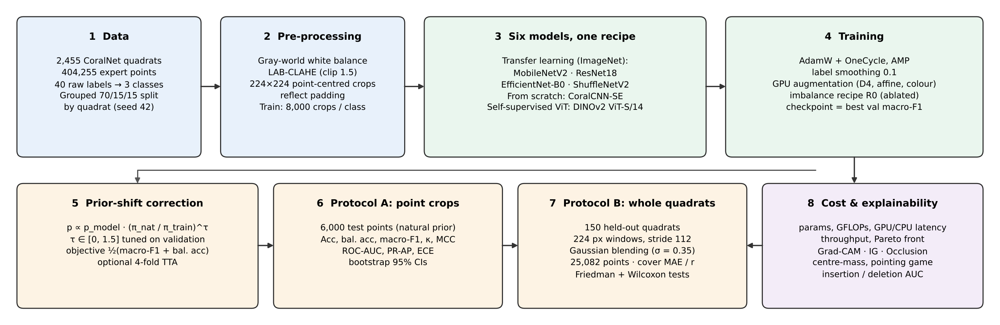
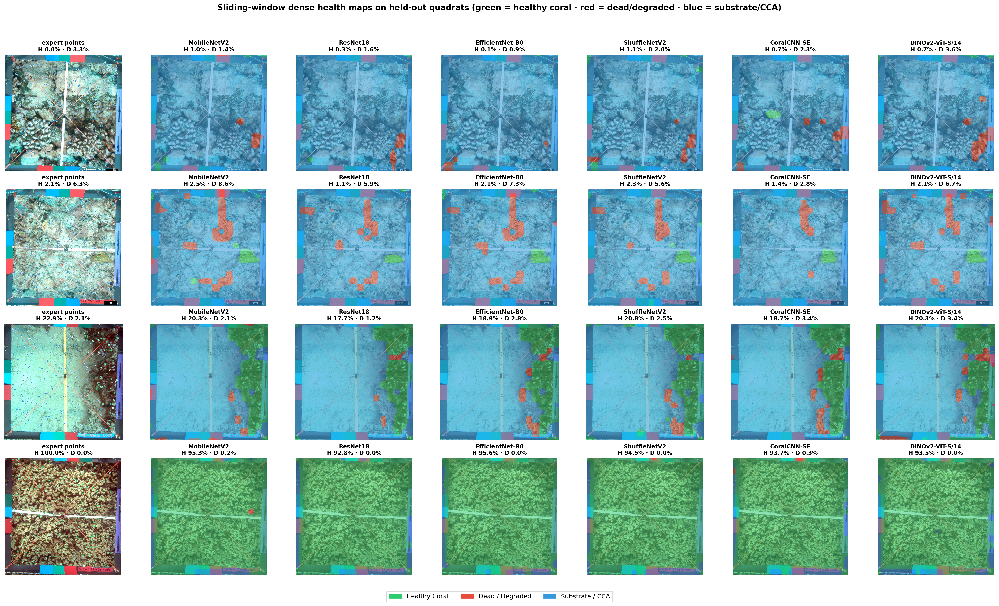

# 🪸 Coral Reef Health Classification — Transfer-Learning CNNs vs a From-Scratch CNN vs a Vision Transformer

[](https://colab.research.google.com/drive/1mITD_pCL3SODsILwt3VUXWFDiemTLxzA)
[](https://huggingface.co/spaces/sasivisvan24084/coral-reef-health-monitor)
  

A **like-for-like benchmark** of six deep-learning models for classifying coral-reef photo-quadrats into **Healthy Coral**, **Dead / Degraded** and **Substrate / CCA**, evaluated both on expert-annotated points and as **live-coral cover maps** of whole quadrats. **Try it online:** the interactive web app is hosted on Hugging Face at **[sasivisvan24084/coral-reef-health-monitor](https://huggingface.co/spaces/sasivisvan24084/coral-reef-health-monitor)**. Upload a reef image and check its coral health.

| Family | Models |
|---|---|
| Transfer learning (ImageNet) | MobileNetV2 · ResNet18 · EfficientNet-B0 · ShuffleNetV2 |
| CNN from scratch | **CoralCNN-SE**: residual CNN with squeeze-and-excitation attention, 4.2 M params |
| Vision transformer | **DINOv2 ViT-S/14**: self-supervised, top-4 blocks fine-tuned, multi-layer token pooling |

All six share the same data split, point-centred crops, augmentation, model-selection rule and prior-shift correction, so differences come from the architecture.

<p align="center"></p>

---

## What this repository contains

| Item | Where |
|---|---|
| **Source code** | [`src/`](src) (model definitions, inference, command-line prediction), [`analysis/`](analysis) (statistics and figures), [`notebooks/coral_reef_final_pipeline.ipynb`](notebooks/coral_reef_final_pipeline.ipynb) (full training and evaluation pipeline) |
| **Dataset information** | [`data/README.md`](data/README.md): source, download steps, 40 → 3 label mapping and the train/val/test split. The images themselves (≈ 18 GB) are downloaded from Kaggle. |
| **Setup and execution instructions** | [Setup](#setup) and [How to run](#how-to-run) below |
| **Results** | [`results/`](results): tables (CSV + PNG), figures, training logs and `results_master.json`. Trained weights for all six models are in [`models/`](models). |
| **Project report** | [`paper/Coral_Reef_Health_Prediction_Using_DL.pdf`](paper/Coral_Reef_Health_Prediction_Using_DL.pdf) |

---

## Key results

**Protocol A: point-crop test set** (6,000 expert points, natural class distribution; 95 % bootstrap CIs)

| Model | Family | Accuracy (%) | Macro-F1 | ROC-AUC | Dead recall | GPU ms / crop | Params (M) |
|---|---|---|---|---|---|---|---|
| MobileNetV2 | TL | 83.85 [82.9, 84.8] | 0.792 | 0.937 | 0.659 | 6.12 | 2.23 |
| ResNet18 | TL | 85.97 [85.1, 86.9] | 0.819 | 0.949 | 0.709 | 5.06 | 11.18 |
| EfficientNet-B0 | TL | 85.82 [85.0, 86.7] | 0.815 | 0.948 | 0.673 | 8.84 | 4.01 |
| ShuffleNetV2 | TL | 83.48 [82.5, 84.4] | 0.794 | 0.939 | 0.720 | 7.64 | **1.26** |
| CoralCNN-SE | Scratch | 83.68 [82.8, 84.6] | 0.800 | 0.939 | **0.745** | **4.12** | 4.16 |
| **DINOv2 ViT-S/14** | ViT | **86.70** [85.8, 87.6] | **0.831** | **0.956** | 0.734 | 8.50 | 22.45 |

**Protocol B: whole-quadrat sliding-window maps** (150 held-out quadrats, 25,082 expert points)

| Model | Point macro-F1 | Live-coral cover MAE (pp) | Pearson r | Reef-status agreement | ms / quadrat (T4) |
|---|---|---|---|---|---|
| MobileNetV2 | 0.773 | 5.54 | 0.939 | 80.7 % | 174 |
| ResNet18 | 0.803 | 3.23 | 0.972 | **92.7 %** | 140 |
| EfficientNet-B0 | 0.795 | 3.72 | 0.959 | 89.3 % | 235 |
| ShuffleNetV2 | 0.795 | 3.66 | 0.973 | 90.7 % | 115 |
| CoralCNN-SE | 0.792 | 3.51 | 0.964 | 90.7 % | **99** |
| **DINOv2 ViT-S/14** | **0.805** | **3.11** | **0.981** | 92.0 % | 506 |

**Takeaways**
* **DINOv2** is the most accurate model on every discrimination metric and the most robust on under-represented image sources (cover MAE 8.2 pp vs 9.3–17.8 pp for the others). Its lead over **ResNet18** in cover error is **not statistically significant** (Wilcoxon, Holm-adjusted p = 1.0), and it needs 3.6× more compute per quadrat.
* The **from-scratch CoralCNN-SE** rivals the ImageNet-pretrained compact CNNs. It is the fastest model on the GPU, recalls dead coral best and has the lowest cover bias (−0.09 pp).
* Most errors for every model are **Dead/Degraded ↔ Substrate/CCA** confusions. Plain balanced sampling beat focal loss, CutMix/MixUp and class-aware strong augmentation.
* **Occlusion** gave the most faithful explanations for all three families. Grad-CAM is unreliable on the ViT.

<p align="center"><br><em>Sliding-window health maps on held-out quadrats (green = healthy coral, red = dead/degraded, blue = substrate/CCA).</em></p>

---

## Repository structure

```
├── src/
│   ├── coral_model_defs.py       # all six architectures (CoralCNN-SE, DINOv2 classifier, TL backbones)
│   ├── inference.py              # colour correction, crops, prior correction, sliding window, cover, overlay
│   ├── predict.py                # command-line inference (whole quadrat / points CSV / single crop)
│   └── load_and_predict_example.py
├── notebooks/
│   └── coral_reef_final_pipeline.ipynb   # full pipeline: data → EDA → training → evaluation → XAI (Colab, T4)
├── analysis/
│   ├── statistical_tests.py      # bootstrap CIs, Friedman + Wilcoxon/Holm tests, error by image source
│   └── make_paper_figures.py     # pipeline + cover-error figures used in the paper
├── models/                       # trained best-epoch weights (*.pt) for all six models (≈174 MB)
├── data/
│   ├── README.md                 # dataset source, download, taxonomy, split
│   ├── label_mapping.csv         # 40 raw labels → 3 health classes
│   └── split_summary.csv
├── results/
│   ├── README_results.md         # verdict + protocol notes
│   ├── results_master.json       # every metric, confusion matrix, τ, configs
│   ├── statistical_tests.json
│   ├── tables/                   # every table as CSV + PNG (table_12_MASTER_comparison = headline)
│   ├── figures/                  # EDA, training, results, sliding window, Grad-CAM, XAI (PNG, 200 dpi)
│   └── logs/                     # per-epoch training histories, imbalance ablation
├── paper/
│   ├── Coral_Reef_Health_Prediction_Using_DL.pdf   # final project report
│   └── figures/
├── requirements.txt
└── LICENSE
```

---

## Setup

```bash
git clone https://github.com/Deepak-EL/Team-No.-2-Neural-Nexus.git
cd Team-No.-2-Neural-Nexus

python -m venv .venv
source .venv/bin/activate            # Windows: .venv\Scripts\activate
pip install -r requirements.txt
# GPU: install the CUDA build of PyTorch first, following https://pytorch.org/get-started/locally/
```

Python 3.10+ is required. Training was run with PyTorch 2.11 on an NVIDIA Tesla T4 (Google Colab). Inference and the web app also run on CPU.

> **Note:** the DINOv2 model downloads its backbone code from `facebookresearch/dinov2` through `torch.hub` (falling back to `timm`) the first time it is loaded, so the first run needs internet access.

---

## How to run

### 1. Interactive web app (no installation)

Open the Hugging Face Space **https://huggingface.co/spaces/sasivisvan24084/coral-reef-health-monitor** (Gradio). Pick one of the models (the four transfer-learning CNNs or CoralCNN-SE), upload a reef image, and get the predicted health class with a **Grad-CAM overlay** showing where the model looked. The Space also showcases the training results, EDA and model comparison. Its source code (`app.py`, `models.py`, `requirements.txt`) is in the Space's *Files* tab.

> The Space serves the image-level models from the earlier project stage. The point-crop models benchmarked in the paper (including DINOv2) are in `models/` and can be run with `src/predict.py` below.

### 2. Command-line inference

```bash
# whole quadrat → health map PNG + cover JSON
python src/predict.py --image path/to/quadrat.jpg --model DINOv2-ViT-S/14 --out outputs/

# classify given points (CSV with columns Row,Column)
python src/predict.py --image path/to/quadrat.jpg --points points.csv --model ResNet18 --out outputs/

# a single crop centred on the point of interest
python src/predict.py --crop path/to/crop.jpg --model CoralCNN-SE
```

Options: `--stride 224|112|56`, `--max-side 1600`, `--no-filter`, `--tau <float>`, `--device cpu|cuda`.
Models: `MobileNetV2`, `ResNet18`, `EfficientNet-B0`, `ShuffleNetV2`, `CoralCNN-SE`, `DINOv2-ViT-S/14`.

### 3. Reproduce the full study (training + evaluation)

**Google Colab (recommended)**
1. Open `notebooks/coral_reef_final_pipeline.ipynb` in Colab (or use the badge above).
2. *Runtime → Change runtime type → T4 GPU.*
3. *Runtime → Run all.* The ≈18 GB Kaggle dataset is downloaded automatically with `kagglehub`.

The `full` profile takes about 1.5–2.5 h on a free T4, including the download. All outputs (figures, tables, models, logs, `results_master.json`) are written to `/content/coral_final/` and zipped for download at the end.

**Local machine / other GPU**

```bash
export CORAL_PROFILE=full            # full | fast (~40–60 min) | cpu | smoke (code test only)
export CORAL_DATASET_PATH=/path/to/coral-reef-dataset   # optional: use a local copy instead of kagglehub
export CORAL_OUT=./coral_final CORAL_CACHE=./coral_cache
jupyter nbconvert --to notebook --execute notebooks/coral_reef_final_pipeline.ipynb --output executed.ipynb
```

Pipeline stages in the notebook: setup → dataset download → taxonomy + grouped split → EDA → underwater colour correction → crop cache → GPU augmentation → model zoo → training (all six models) → point-crop evaluation (raw / +τ / +τ+TTA) → efficiency → sliding-window evaluation → stride study → Grad-CAM → master comparison and export.

### 4. Reproduce the statistics and paper figures

```bash
python analysis/statistical_tests.py      # → results/statistical_tests.json
python analysis/make_paper_figures.py     # → paper/figures/
```

---

## Method summary

* **Data:** 404,255 expert point annotations on 2,455 CoralNet quadrats (mostly Moorea MCR-LTER), with 40 raw labels mapped to 3 classes. The split is grouped by quadrat (70/15/15) to prevent spatial leakage. See [`data/README.md`](data/README.md).
* **Pre-processing:** gray-world white balance + LAB-CLAHE, then 224 × 224 crops centred on each point (reflection padding). Training uses 8,000 crops per class, balanced; validation and test keep the natural class distribution.
* **Training:** AdamW with backbone/head learning rates, OneCycle, label smoothing 0.1, AMP, gradient clipping, and GPU augmentation (dihedral flips/rotations, small affine, colour jitter). The checkpoint is chosen on **validation macro-F1**.
* **Imbalance:** four recipes were ablated (baseline / class-aware strong augmentation / CutMix-MixUp / focal loss + class weight). The baseline won. At inference, a **prior-shift correction** `p ∝ p_model · (π_nat / π_train)^τ` is applied, with τ tuned on validation.
* **Evaluation:** Protocol A (point crops) and Protocol B (whole-quadrat sliding window: 224 px windows, stride 112, Gaussian blending), plus live-coral cover error, efficiency (params, FLOPs, GPU/CPU latency, throughput) and explainability (Grad-CAM, Integrated Gradients, Occlusion with centre-mass, pointing-game and insertion/deletion faithfulness).

---

## Results files

| What | Where |
|---|---|
| Headline comparison | `results/tables/table_12_MASTER_comparison.csv` / `.png` |
| Point-crop metrics, per-class metrics, τ/TTA ablation | `results/tables/table_05*`, `table_07*`, `table_06*` |
| Sliding-window metrics, stride study | `results/tables/table_09*`, `table_10*` |
| Per-quadrat expert vs predicted composition (all models) | `results/tables/sw_per_image_composition_long.csv` / `_wide.csv` |
| Class + probabilities of every sliding window | `results/tables/sliding_window_per_window_predictions.csv.gz` |
| Efficiency / latency | `results/tables/table_08_efficiency_latency.csv` |
| Grad-CAM + XAI faithfulness | `results/tables/table_11*`, `table_xai_faithfulness.csv`, `results/figures/gradcam_*`, `xai_*` |
| Training curves and per-epoch logs | `results/figures/train_*`, `results/tables/table_epochs_*`, `results/logs/` |
| All metrics in one file | `results/results_master.json` |

---

## Project report

[`paper/Coral_Reef_Health_Prediction_Using_DL.pdf`](paper/Coral_Reef_Health_Prediction_Using_DL.pdf): *Coral Reef Health Prediction Using Deep Learning*, the final project report (22AIE304 Deep Learning, October 2026).

## Team

Team No. 2 – Neural Nexus: A Susindhar, E L Deepak, Kaarthikeyan A R and Sasi Visvan C, under the guidance of Dr. M. Pallavi.

## Acknowledgements

Course project for 22AIE304 Deep Learning, Amrita School of Computing, Amrita Vishwa Vidyapeetham, Chennai. Imagery and annotations come from the Moorea Coral Reef LTER programme and the CoralNet community, via the Kaggle `jxwleong/coral-reef-dataset`. DINOv2 is by Meta AI; the ImageNet backbones are from torchvision.

## License

Code is released under the MIT License (see `LICENSE`). The dataset is **not** covered by this licence; follow the terms of the original data providers.
